# PayControl 1.3 — Ekran Görüntüleri

Görüntüler sentetik demo verisiyle (gerçek kişi/ödeme bilgisi yoktur) Windows üzerinde uygulamanın kendisinden üretilmiştir:

```powershell
PayControl.exe --ekran-goruntusu C:\Cikti
```

Bu mod geçici bir veritabanı kullanır, kullanıcının verisine dokunmaz. GitHub Actions her derlemede görüntüleri yeniden üretir (`PayControl-Ekran-Goruntuleri` artifact'i).

| Ekran | Dosya |
|-------|-------|
| Giriş | 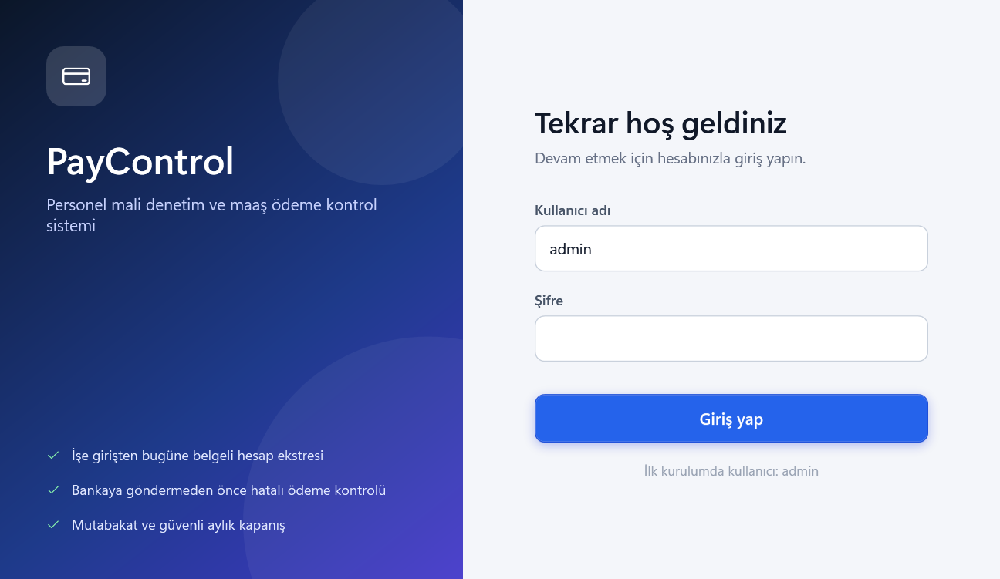 |
| Ana ekran — genel bakış (gösterge paneli) | 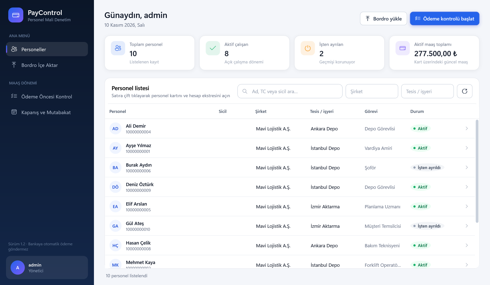 |
| Personel kartı — hesap ekstresi | 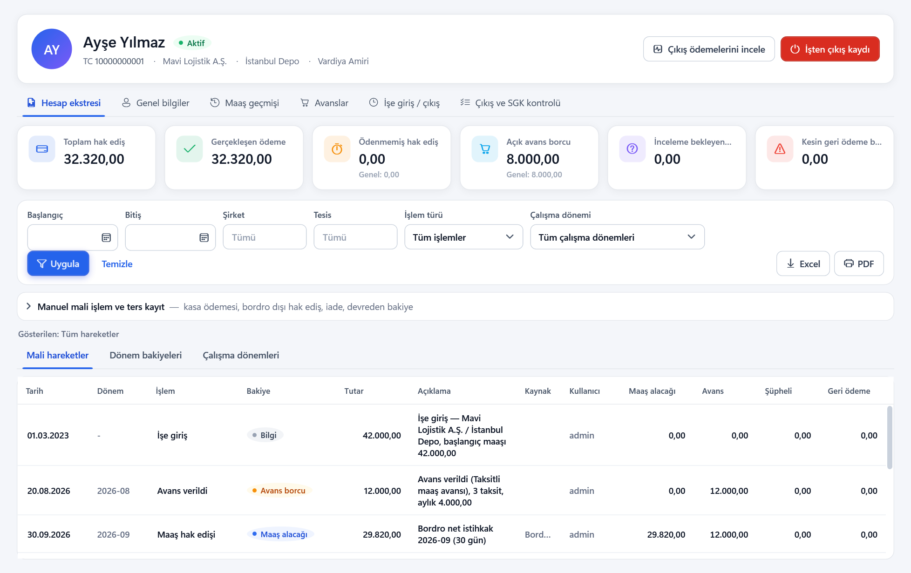 |
| Ödeme öncesi kontrol | 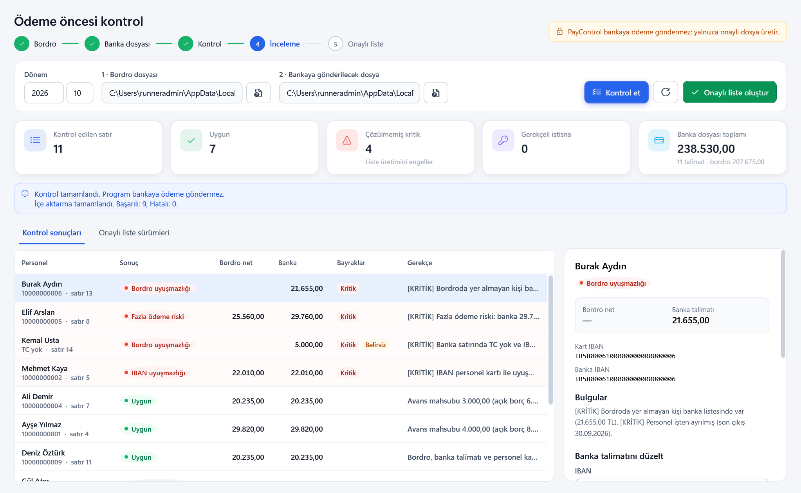 |
| Kapanış ve mutabakat | 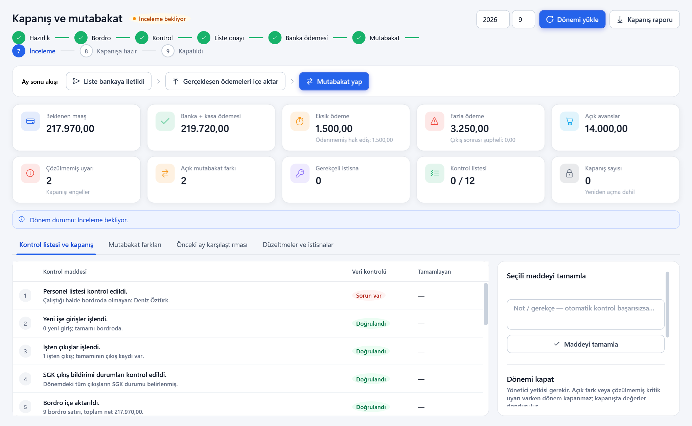 |
| Bordro içe aktarma | 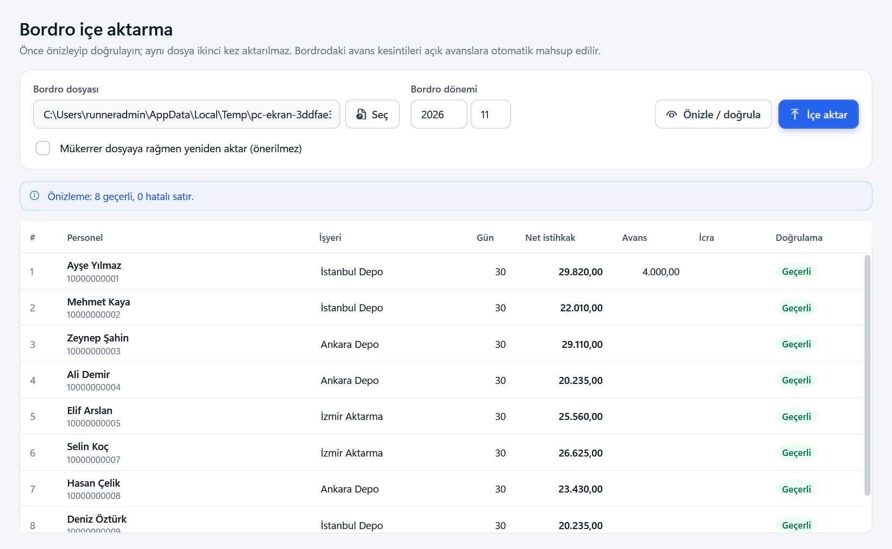 |
| İşten çıkış kaydı | 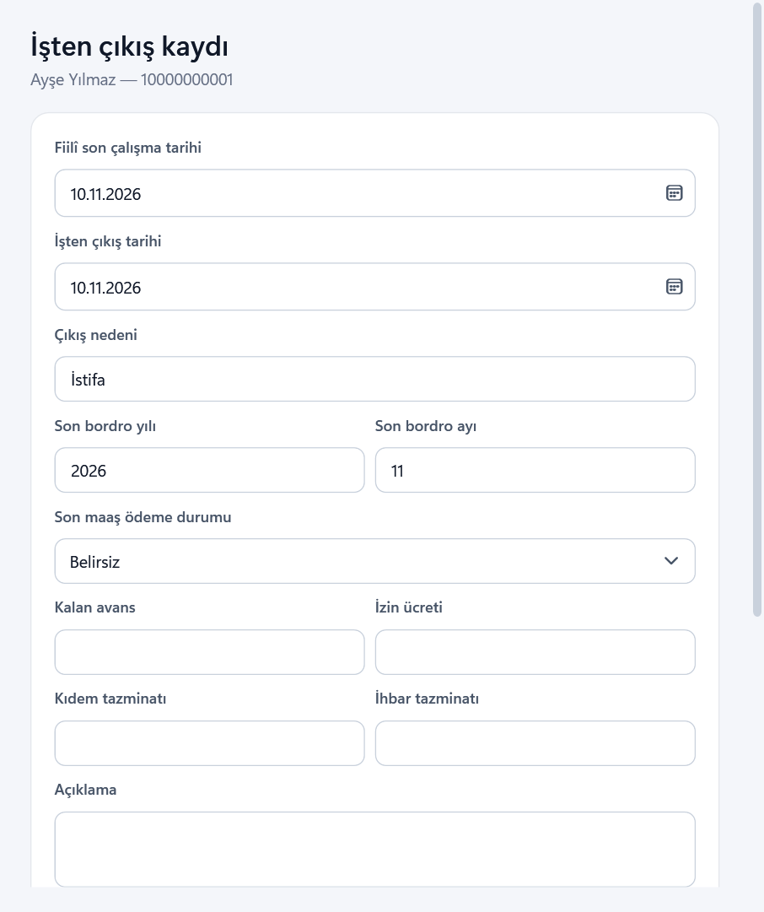 |
| Rapor merkezi — tesis karşılaştırma | 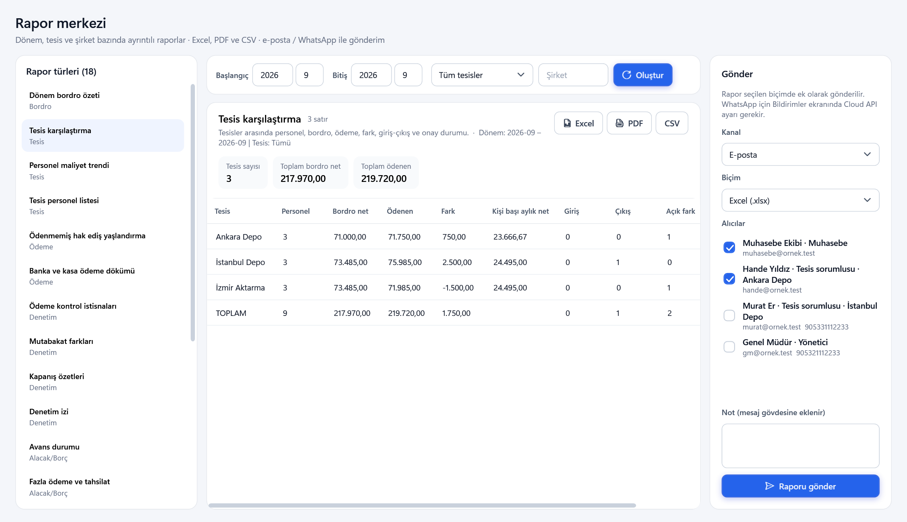 |
| Bildirimler — otomatik kurallar | 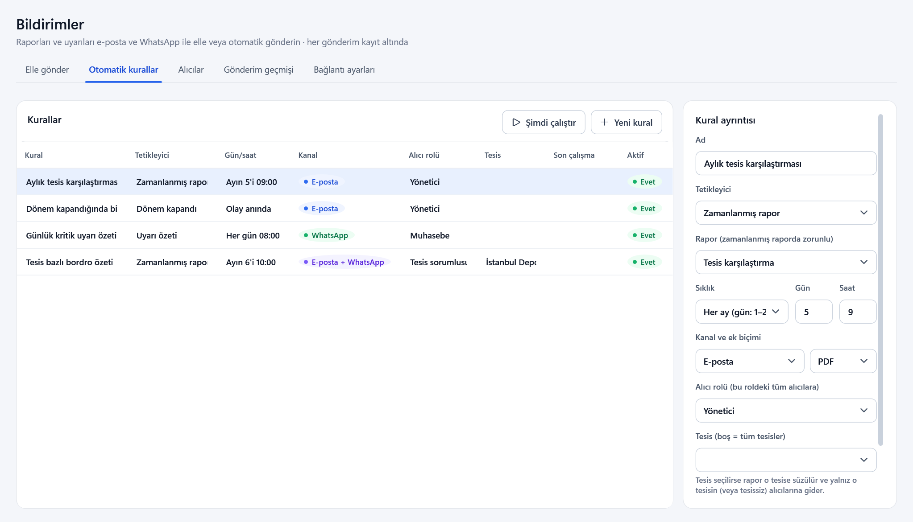 |
| Uyarı merkezi | 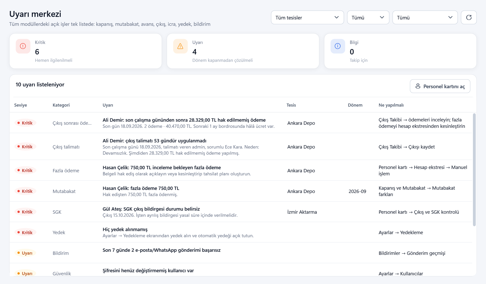 |
| Tesisler — dönem tesis onayları | 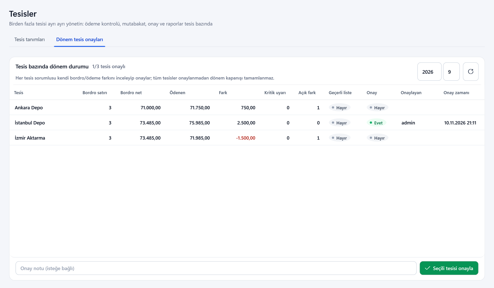 |
| Denetim geçmişi | 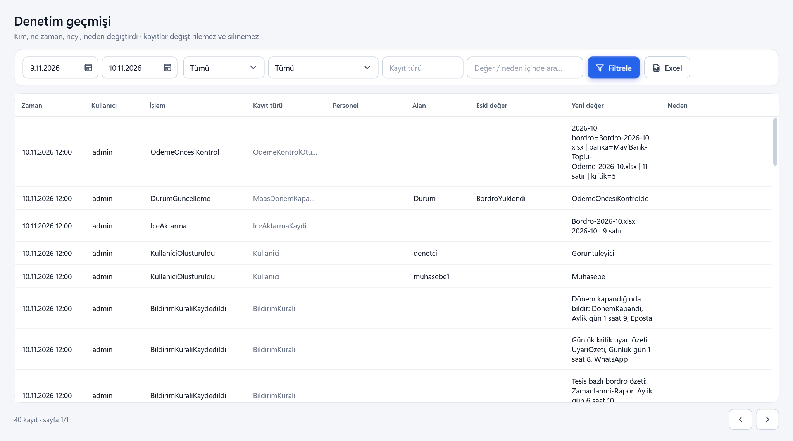 |
| Ayarlar ve yönetim — kullanıcılar | 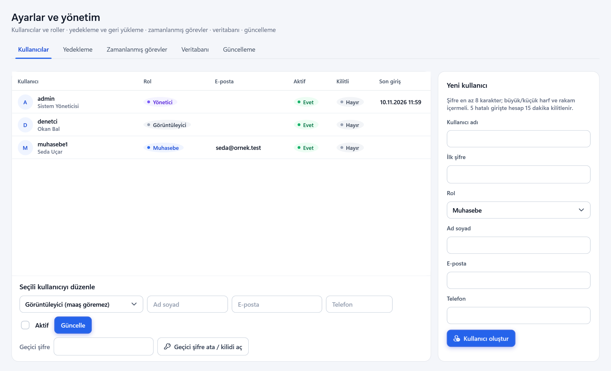 |
| Personel kartı — icra / BES / tahsilat | 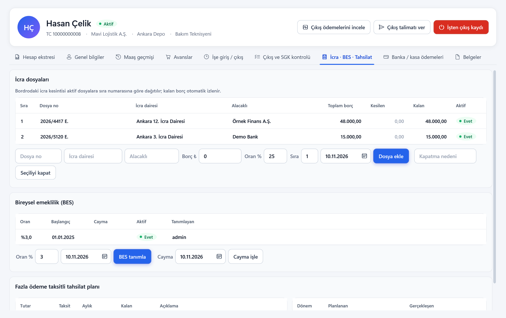 |
| Çıkış takibi (İK çıkışı unutursa) | 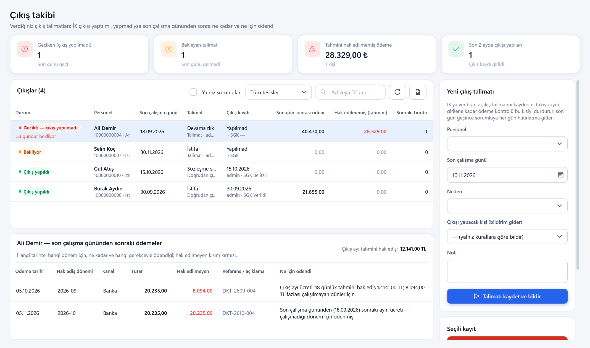 |
