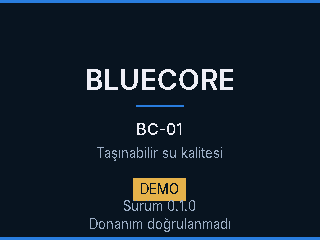
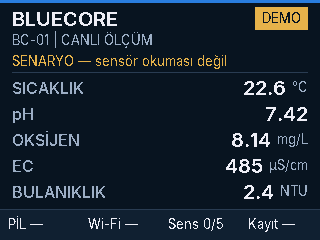
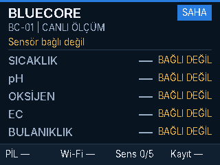
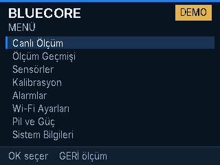
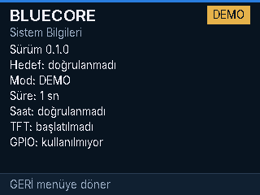

# Arayüz

Ekran 320×240 kabulüdür. Panel sürülmez. Çizim `Canvas` üzerindedir. Cihazda `NullCanvas`, hostta framebuffer vardır.

Tema koyu lacivert zemin, mavi vurgu, demo için amber etikettir. Gereksiz animasyon yoktur.

## Ekranlar

Açılış 1,6 saniye durur. OK, Menü veya Geri onu geçer.

Canlı ölçüm başlığı `BLUECORE`, alt satır `BC-01 | CANLI ÖLÇÜM`. Demo etiketi ve `SENARYO — sensör okuması değil` uyarısı senaryo sayılarının yanında durur. Saha modunda sayılar yerine `—` ve `BAĞLI DEĞİL` vardır.

Alt bilgi kısa yazılır: `PİL —`, `Wi-Fi —`, `Sens 0/5`, `Kayıt —`. Tire, ölçülmediği veya kapalı olduğu anlamına gelir. Ayrıntı sistem, pil ve Wi-Fi sayfalarındadır. 320 pikselde "KAPALI" ve "SENSÖR" aynı hücreye sığmaz.

Menü: Canlı Ölçüm, Ölçüm Geçmişi, Sensörler, Kalibrasyon, Alarmlar, Wi-Fi Ayarları, Pil ve Güç, Sistem Bilgileri.

Bilgi sayfaları uydurma grafik çizmez. Sistem sayfası saati `doğrulanmadı`, TFT'yi `başlatılmadı`, GPIO'yu `kullanılmıyor` diye yazar.

Önizleme:

## Tuşlar

Soyut kimlikler: Menü, Yukarı, Aşağı, OK, Geri. GPIO eşlemesi yoktur.

- Debounce 30 ms
- Uzun basma 600 ms
- Yukarı ve aşağı, debounce sonrası bir adım, uzun basmadan sonra 150 ms tekrar
- OK, Menü ve Geri tıklaması bırakınca oluşur; uzun basma tıklama sayılmaz
- Menü, menüdeyse canlı ölçüme döner, değilse menüyü açar
- Geri, alt sayfadan menüye, menüden canlı ölçüme gider
- Seri deneme: `m` `u` `d` `o` `b`

Yazı tipi Türkçe alt küme içerir. Yeni bir karakter eklenirse `tools/gen_font.py` yeniden çalıştırılır ve `make test` glyph kapsamasını denetler.
